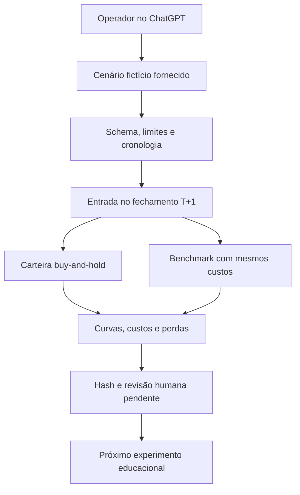

# AI Hedge Fund → Radar Equity Replay Lab

Auditoria em18/10/2026. Upstream: [virattt/ai-hedge-fund](https://github.com/virattt/ai-hedge-fund/tree/78b779c1389e2d1452dc29606d2c4126d859b964), commit `78b779c1389e2d1452dc29606d2c4126d859b964`, pacote aihf2.5.0. Decisão principal: **C — EXTRACT**. O pedido de novo repositório foi atendido com implementação original limitada e pacote para ChatGPT, não um fundo autônomo ou fork integral.

## 1. Executive Summary

O projeto é útil para estudar separação entre sinal, construção de carteira, risco, execução simulada e memória por sessão. A versão atual é CLI/TUI Python e contém paper/backtest, não uma aplicação web ou broker real. O motor principal aplica decisão T→execução T+1; isso não elimina todos os vieses, inclusive memória futura de LLM, dados do provedor e seleção do universo.

Foi criado `radar-equity-replay-lab`, laboratório original MIT com arquivos fictícios, cronologia explícita, custos de entrada/saída e benchmark comparável. Há instruções PT-BR para ChatGPT. Nenhuma conta, ordem real, feed pago, n8n, banco ou produção foi conectado. Código e auditoria ficam em PRs independentes para revisão humana.

## 2. GitHub Ecosystem Context

Inventário atual anterior à criação: **42 repositórios públicos**, todos com metadados consultados; sete relevantes receberam inspeção de arquivos/branches em commits fixados. Não publicar nomes/conteúdo privados. Dados públicos em public-ecosystem.json; pushed_at/descrição não comprovam manutenção, qualidade ou produção.

Python aparece em11repositórios com linguagem reportada; TypeScript em3 e JavaScript em2;26sem metadado de linguagem. Nulo não significa ausência de código. O ecossistema já reúne documental/RAG, evidências/governança, produtos/portais, audiovisual, pesquisa financeira, segurança, memória/agentes e laboratório Colab. A contagem registra estado anterior à criação e não uma promessa de inventário permanente.

TradingAgents já tem laboratório português de teses/riscos numa PR aberta. Capital Web3 tem evolução cloud sintética documentada em branch atual, enquanto main é antiga; não tratá-lo como somente protótipo local. O novo componente concentra replay temporal e avaliação de hipóteses, preservando o domínio DeFi e evitando outro grafo de personas.

## 3. Repository Overview

[CODE VERIFIED]115arquivos rastreados,95Python,27arquivos test_*.py,5YAML. Stack: Python≥3.11, Poetry, Pydantic2, LangChain/SDKs, NumPy/Pandas/SciPy, requests, Rich e Textual. Entrypoint `aihf=hedge_fund.run:main`. Lock com108pins e hashes.

Módulos: data/caches; features de fundamentos; sinais quantitativos e LLM; especificações de fundo/estratégia; construção e limites; brokers simulado/paper; pipeline; ledger; backtesting; estudo de eventos; TUI. Não há frontend web, Dockerfile, servidor MCP, AGENTS.md ou workflow CI neste commit. Parte da documentação cita v1/src/app ausentes: é deriva documental, não componente presente.

## 4. Evidence Level

| Nível | Evidência |
| --- | --- |
| CODE VERIFIED | Módulos, licença, lock, validações, pipeline e fronteiras lidos |
| TEST VERIFIED |625testes upstream aprovados/38ignorados; build wheel/sdist;6observações de segurança e2limitações do harness reproduzidas |
| DOC CLAIM | Potencial educacional, qualidades do provedor, resultados citados em comentários e itens de roadmap |
| INFERENCE | Adequação ao ecossistema, risco condicionado à entrada/deployment e hipótese de produto |
| NOT VERIFIED | Dados financeiros reais, providers live, LLM pago, execução de investimento, rentabilidade, escala, produção e E2E do app interativo real |

Suíte foi executada sem credenciais herdadas, HOME isolado e guard Python de socket/DNS: **zero tentativas registradas**. Isso não é sandbox universal. Os38ignorados dependem de Financial Datasets live. Não somar logs, builds, subcasos, contagem de funções ou testes de observação como testes financeiros adicionais.

Motor novo:30testes próprios e25independentes aprovados, com versão final fixada por hash. CI de implementação é registrada na PR, separada da validação upstream e do patch candidato. Um ensaio de instruções em contexto novo executou o exemplo e manteve custos/limites, sem converter evidência em aprovação ou preparar ordem; ver chatgpt-rehearsal.md. Homologação humana no ChatGPT permanece pendente.

## 5. License & IP

MIT upstream, **Copyright(c)2024Virat Singh**, conferida no arquivo LICENSE. Preservar aviso em cópias/partes substanciais. Atribuição/texto mantidos em third_party/ai-hedge-fund. Motor/instruções novos são originais MIT de Carlos Felipe; patch de auditoria deriva do upstream e mantém sua licença.

Nenhum dataset, peso, logo, persona, cache, chave ou runtime upstream integra o motor novo. Não inferir endosso de investidores famosos. MIT não transfere contratos do provedor, direitos de dados de mercado, serviços ou marcas.

Os [termos Financial Datasets](https://www.financialdatasets.ai/terms-of-use), consultados em18/10/2026 e datados de16/10/2026, distinguem planos e restringem redistribuição/revenda de dados brutos. Uso comercial precisa conferir contrato específico. Não houve API/contratação ou redistribuição desse feed nesta entrega.

## 6. Architecture Review

Ponto forte: `advance` mantém reconciliação→execução pendente→marcação→nova avaliação; backtest principal e paper compartilham caminho. O LLM forma sinais, enquanto sizing/limites/execução são determinísticos. O ledger permite replay e comparação de book.

Limites: hash-chain local sem âncora externa não autentica autoria/imutabilidade contra dono do disco; cache precisa identidade de fonte; fronteira PIT confia no provedor; escrita atômica com temporário previsível é insegura em diretório compartilhado. Não chamar consistência mecânica de prova econômica.

## 7. Code Quality

625testes aprovados e tipagem/Pydantic são positivos, mas não eliminam caminhos defeituosos não cobertos. Há duas rotas de backtest com semânticas diferentes e documentação v2 obsoleta. Build wheel/sdist e pip check passaram.

Black falhou em60/95arquivos, isort em30 e flake8 apontou1.242ocorrências,1.196E501. Configuração de linha Black420 não corresponde ao padrão flake8; isso é dívida de ferramentas, não1.242falhas funcionais. Também há F401/F541/F841. Não foi configurado/executado type-check; não alegar aprovação. Nenhuma formatação em massa foi aplicada.

## 8. Security Audit

Seis mecanismos confirmados em mocks/diretórios fictícios, sem conta ou exploração remota. Severidade depende das condições:

| ID | Evidência | Impacto condicionado | Prioridade/correção |
| --- | --- | --- | --- |
| SEC-01 | data/client.py:238–275 | Paginação aceita outra origem com X-API-Key; resposta adulterada pode divulgar chave |Alta no conector autenticado; HTTPS/origem exata, redirects recusados, ciclos/teto|
| SEC-02 | paths.py:43–49 | Temporário previsível segue symlink se terceiro escreve no diretório |Média; criação exclusiva/única, confinamento e serialização|
| SEC-03 | FundSpec.name e run.py:208–211 | Nome de YAML não confiável grava fora de research |Média; ID de arquivo seguro e validação de confinamento|
| SEC-04 | data/cached.py:116–133,167–171 | Cache compartilhado mistura fontes/versões |Média de pesquisa; namespace explícito e envelope validado|
| SEC-05 | data/client.py:207–214 | get_market_cap acessa campo ausente e gera AttributeError |Baixa funcional; obter métrica arquivada correta, sem usar atual no histórico|
| SEC-06 | features/snapshot.py:191–225 | Resposta de fonte que viola contrato pode incluir publicação futura |Média de pesquisa; revalidar cutoff/ticker/revisão localmente|

**6/6testes de observação** passaram porque reproduzem o comportamento atual, não seis correções. Detalhes/condições/controles positivos em security-review.md. Validar FD legítimo ou exploração externa não ocorreu. Cache/hash não são identidade/autorização e prompts não substituem controles aplicados.

Consulta de108pins retornou18registros, **13advisories distintos em oito pacotes**, incluindo ferramentas de desenvolvimento Black/pytest. Faixa afetada não prova exposição da aplicação: alguns componentes LangChain reportados não são usados. JSON, aliases, fontes e correções indicadas em DEPENDENCY-ALERTS.md. Upgrade major LangChain exige migração/regressões; não atualizar cegamente ou anunciar todos os avisos como exploração confirmada.

## 9. Performance

Caches reduzem solicitações repetidas; hash do snapshot evita inferência sobre dados iguais. Não há benchmark de latência, memória, p95, usuários ou custo por hipótese aprovada. Modelos/personas/ativos/sessões podem multiplicar chamadas; cache aquecido não torna toda operação offline/gratuita.

Cliente FD tem timeout/retries, mas faltam limites agregados de bytes/linhas/deadline. Patch candidato impõe teto de100páginas, sem resolver essas outras quotas. O motor novo limita1MiB/20ativos/2.500sessões e não faz rede. Nenhuma promessa de SLA/escala foi derivada disso.

## 10. Scalability

| Cenário | Avaliação |
| --- | --- |
| Um operador/local | Ambiente coerente com CLI/TUI experimental, com diretório exclusivo |
|10operadores|Instâncias/dados/chaves separados; coordenação e consumo ainda precisam ser medidos|
|100–1.000usuários|Exige serviço, autenticação, quotas/custos, isolamento, filas/retention e benchmark|
|10.000/multitenant|Não projetado/validado; não inferir a partir de funções ou Docker futuro|

Não há RLS, tenant autenticado ou isolamento de serviço no novo CLI. project_id não concede permissão. Nem upstream nem adaptador são SaaS white-label homologado nesta análise.

## 11. AI Engineering

O upstream combina sinais quantitativos e agentes LLM, snapshots compactos, caches, modelos estruturados e validação determinística. Confiança de um sinal não é probabilidade de lucro. Provider/LLM/dependências devem ter versão, custo, erro e origem rastreáveis.

Modo cego oculta datas/ticker/valores absolutos e reduz identificação, mas o próprio código reconhece memorização residual. Modelo treinado depois pode conhecer os eventos. Validação out-of-sample, survivorship, revisões de dados, seleção do universo e custos reais não foram demonstrados. CPCV/PBO são roadmap, não recursos validados.

No laboratório novo, ChatGPT explica o artefato; o motor não contém modelo, prompt executor ou API paga. Custos adicionais de API do núcleo: zero chamadas. Assinatura/ambiente/hora do operador continuam separados. [Investor.gov](https://www.investor.gov/introduction-investing/general-resources/news-alerts/alerts-bulletins/investor-alerts/artificial-intelligence-fraud) alerta para limites de informação gerada por IA em decisões financeiras; não usar narrativa de IA como garantia.

## 12. Agentic AI

A separação entre analistas, política e risco é referência útil. Não é necessário replicar5personas ou outro planner neste novo componente: pesos e hipóteses são declarados, replay é determinístico, revisão continua humana.

TradingAgents já ocupa o papel de teses/contrapontos no ecossistema. Agentes usados para engenharia/revisão desta tarefa não estão instalados no produto. Não há executor autônomo persistente ou agendamento implicitamente habilitado.

## 13. RAG

Snapshots de fundamentos e caches não equivalem a pipeline RAG vetorial com ingestão, ACL, busca, reranking e avaliação de groundedness. Não introduzir embeddings/pgvector apenas porque o projeto usa LLM.

Fontes/evidências precisam de origem/licença/data verificáveis num futuro consumidor. Na entrega atual, URLs.invalid/textos são fictícios e nenhuma busca é realizada. Hash garante vínculo de bytes, não qualidade factual.

## 14. MCP Opportunities

Não há servidor MCP no upstream atual nem no adaptador. Futuro serviço read-only de avaliação poderia ser útil a múltiplos consumidores, mas não é necessário para chamar uma função local neste marco.

Dados externos exigem conector realmente disponível, escopo/licença e limites de custo. Operações financeiras pedem fronteira e projeto próprios; nunca expor broker por simplesmente adaptar uma função a tool. Hub existente pode hospedar governança após contrato/homologação específicos, hoje não conectados.

## 15. n8n Opportunities

Futuro fluxo possível: receber artefato consentido→validar/calcular→fila de revisão→arquivar relatório aprovado. Cálculos e critérios financeiros continuam em código. Não usar n8n como motor de investimento ou incorporar lógica crítica em workflow gigante.

Nenhum workflow, cron, serviço VPS ou conexão foi criado/ativado. Uso comercial/white-label exige revisar edição/termos do n8n no contexto concreto, sem presumir autorização por esconder editor.

## 16. Infrastructure

Upstream é CLI/TUI com disco local; não há container/frontend web implantado. O laboratório novo usa Python3.11+ stdlib, Linux/POSIX e arquivos limitados. CLI Windows não homologado e IO incompatível falha fechado. Não precisa GPU, VPS, banco, Redis, Kafka, Kubernetes ou novaUI neste estágio.

ChatGPT é a interface conversacional, com instruções/fontes e execução de código quando disponível. A [documentação oficial de projetos](https://learn.chatgpt.com/docs/projects) foi consultada em18/10/2026; fonte anexada não instala código ou dá acesso a pasta/conta. Nada foi instalado automaticamente no ChatGPT do usuário.

## 17. Observability

Upstream inclui registros de sessão, eventos, hashes e custos/cache de LLM em partes do código. Ledger local facilita investigação, mas não é âncora externa ou autenticação de fonte. Erros, volume/custo global, concorrência e quotas precisam de aplicação operacional.

Adaptador produz versão de schema, hash, datas, ponteiros, modelo de custo, métricas/curvas e limitações. Não ecoa IDs/texto/URL. Isso não torna dados comerciais anônimos ou autoriza publicação. Não existe telemetria/monitoramento persistente, retenção automática, alerta ou stack de observabilidade instalada.

## 18. Stack Decision Matrix

| Tecnologia | Decisão | Razão/custo/saída |
| --- | --- | --- |
|Python/Decimal/stdlib|ADOPT|Cálculo reproduzível e baixo acoplamento; sem dependência runtime nova|
|Markdown/JSON|ADOPT|Contrato portável, instruções e saída inspecionável|
|ChatGPT|EXPERIMENT|Explicação/estudo, homologação humana pendente|
|AI Hedge Fund completo|STUDY/EXTRACT|Bom material, riscos/dependências e duplicação de agentes|
|LangChain/SDKs no novo núcleo|Não adicionar|Replay não precisa de LLM; upstream segue dependências próprias|
|Supabase/pgvector/Redis|Não adicionar|Sem requisito de serviço/dados compartilhados nesta fase|
|MCP/n8n/Hub/Router|WATCH|Integração só após utilidade e contrato/orçamento comprovados|
|Broker/feed real|Não adotar neste marco|Dados, licença, autoridade e custo não homologados|

Não houve contratação. Saída da tecnologia atual é exportar JSON/Markdown, sem migração de banco ou conta.

## 19. GitHub Integration Map

| Destino | Papel futuro | Fronteira preservada |
| --- | --- | --- |
|TradingAgents|Teses/contrapontos e comparação de hipótese|Não duplicar grafo/avaliação narrativa|
|Capital Web3 Advisor|Diagnóstico DeFi e entrega privada|Não portar motor sem licença e não misturar ações com COFRE|
|Evidence Kit|Contratos/recibos reais por versão|Hash próprio não se declara recibo SDK|
|Integration Hub|Autoridade/conectores/custos|Não há broker/conector financeiro conectado|
|Model Router|Metadados de roteamento/orçamento futuro|Não chama LLM por si; desnecessário para replay|
|Agent Observatory|Visualização futura de recibos|Main/branches diferentes; loader não é integração genérica|
|Radar OaaS|Hipótese/prontidão de produto|Não mede alpha/suitability; licença de reutilização não presumida|

Pins e estados de main/PR estão em ecosystem-notes.md. Nenhum desses repositórios foi alterado. Não transformar descrição/homologação documentada numa execução nova desta auditoria.

## 20. Product Opportunities

Problema: simulações podem parecer convincentes enquanto escondem entrada irreal, taxas, perda ou evidência posterior. ICP inicial: operador técnico/educador que deseja conferir artefatos hipotéticos e aprender metodologia, não investidor buscando recomendação automatizada.

Valor proposto: explicar hipóteses e permitir auditoria de uma simulação pequena. MVP: contrato/limites, pesos fornecidos, T+1, custos, benchmark e guia ChatGPT. Moat e disposição a pagar não demonstrados; simples replay não justifica outra gestora/SaaS. Preço é hipótese de serviço educacional/validação futura, sem número inventado ou proposta de investimento.

Operação local tem custo de CPU/armazenamento e revisão; nenhuma chamada paga embutida. Para comercialização futura, definir responsabilidade, licenças e público com profissionais competentes. Não afirmar readiness regulatória ou promessa de retorno.

## 21. Architecture 2.0

Não há conexão com corretora ou aresta de ordem/publicação. Preços futuros marcam a carteira, mas não escolhem pesos no algoritmo. A origem dos pesos e dos timestamps continua não autenticada. ADR0001 registra alternativas e limites.

## 22. Code Improvements

Patch candidato de rede `docs/audit/security-fd-boundary.patch`, aplicado apenas à cópia isolada do upstream. Requer HTTPS e mesma origem, recusa redirects, detecta ciclos e limita100páginas. `git apply --check` passou no commit base. **18testes focais aprovados,35integrações ignoradas** (12existentes+6novos); não foi repetida toda suíte625sobre o patch. Limites de bytes/tempo e demais cinco achados continuam pendentes.

Demais correções propostas: nome seguro/confino de research; temporários exclusivos e coordenação por fundo; namespace/envelope de cache; métrica histórica para market_cap; revalidação PIT local. Não há mudança remota no upstream nem alegação de remediação completa.

Motor original novo evita conector/cache/broker e implementa JSON estrito, Decimal próprio, datas/limites, saída exclusiva e recusa symlinks. Últimos ajustes incluem contexto Decimal independente do processo e erros CLI sem eco de argumentos. Os testes verificam comportamento; não validam investimento real.

## 23. Technical Scorecard

Notas de revisão contextual do **upstream público**,0–10, não ranking global, auditoria de gestora ou benchmark de retorno. N/A quando não foi medido:

| Dimensão | Nota | Evidência |
| --- | --- | --- |
|Architecture|8|Pipeline compartilhado, contratos e separação de risco/sinal|
|Code Quality|6|Testes/tipos úteis; helpers e harness divergentes; lint falha|
|Security|5|Limites positivos; seis mecanismos condicionados; advisories|
|Reliability|6|625testes e reconciliação; escrita/cache/PIT exigem hardening|
|Performance|N/A|Sem benchmark operacional ou custo de dados/modelo|
|Scalability|N/A|Sem serviço multiusuário/carga/isolamento validado|
|Testing|8|625pass/38skip, mocks; live/qualidade econômica continuam não validados|
|Documentation|6|Guia principal claro; READMEcore/roadmap divergem do snapshot|
|DevOps|4|Lock/hash/build, mas sem CI atual e ferramentas de estilo incoerentes|
|AI Engineering|7|Snapshots/caches/schemas e modo cego; memória futura/alpha não medidos|
|Agentic Architecture|7|Sinais separados de sizing/risco; dispensa copiar personas|
|Innovation|6|Combinação educacional útil, novidade/ganho não quantificados|
|Maintainability|6|Módulos definidos; dependências e caminhos paralelos elevam custo|
|Fit GitHub|7|Boa referência de avaliação; TradingAgents já cobre pesquisa narrativa|
|Fit Help Mídias|5|Valor de aprendizado/engenharia, não demanda central de agência demonstrada|
|Product Potential|5|Hipótese educacional; demanda/resultado/disposição a pagar não medidos|

Não calcular média fingindo N/A=zero. Testes e CI não equivalem a retorno econômico ou produção. Não atribuir nota de maturidade financeira ao novo laboratório por suas fixtures passarem.

## 24. Adoption Decision

**C — EXTRACT**, principal. Aproveitar cronologia, evidências e separação de risco/cálculo. Novo repositório solicitado recebe implementação original dessa fatia, sem reempacotar o motor como autoria exclusiva ou gestor autônomo.

Fork MIT completo é possível se houver intenção de contribuir/manter o upstream; não necessário para esta adaptação. Evitar copiar outro grafo financeiro ou conectar provedores apenas para aumentar o portfólio. Melhor uso imediato: aprender a avaliar uma simulação e suas limitações.

## 25. Build vs Adopt vs Buy

| Caminho | Benefício | Custo/risco/lock-in |
| --- | --- | --- |
|BUILD recorte original|Método/IO/limites próprios, sem API ou broker|Menos funcionalidades, necessidade de validação humana; não gera estratégia|
|ADOPT upstream|TUI, agentes, paper, backtests, cache e testes|Dependências/contas/dados; achados e vieses; manutenção e homologação|
|BUY ferramenta/dados|Pode reduzir coleta/operação|Preço/termos específicos não comparados; dados/retention e saída do fornecedor|

Decisão: EXTRACT conceitual+BUILD do componente solicitado. Nenhum fornecedor foi comprado/conectado. Reavaliar ADOPT/BUY somente com requisito medido, orçamento e direitos de dados esclarecidos.

## 26. Repository Strategy

`radar-equity-replay-lab`, público/experimental, MIT autoral com atribuição upstream. Main inicial somente bootstrap. Duas PRs independentes: auditoria/patch/evidências e runtime/contrato/testes/guia ChatGPT. Sem dependência de merge ou stack nativa; a licença original/atribuição é idêntica nas duas.

Rota de revisão da implementação: README/CONTRACT/ADR→core/IO/CLI→testes/exemplos→instruções ChatGPT. Auditoria: relatório→mapa/achados→patch focal→resumos/logs gerados. Arquivos gerados grandes são evidência, não código oculto. Não publicar dados privados, install logs com configuração de índice ou artefatos de ambiente sensíveis.

## 27. Implementation Roadmap

| Fase | Marco e estado |
| --- | --- |
|0 Due diligence|Licença, inventário, testes e evidências desta auditoria concluídos no escopo|
|1 PoC|Replay e três exemplos fictícios preparados/testados|
|2 Hardening|Validação/IO/custos/revisão independente; CI por versão na PR|
|3 Integration|Homologar uso humano no ChatGPT; depois consumidor TradingAgents/Evidence Kit se houver necessidade|
|4 Observability|Medir erros/tempo/rejeições com dados redigidos no piloto|
|5 Evals|Comparação independente, datasets adequados, vieses e avaliação fora da amostra antes de alegações econômicas|
|6 Production|Novo mandato, direitos de dados, autenticação/isolamento, operação e revisão competentes|
|7 Scale|Carga, concorrência, quotas e orçamento medidos antes de infraestrutura adicional|
|8 Productization|Demanda/disposição a pagar e responsabilidade operacional/regulatória avaliadas|

Fases3–8 são propostas. CI/ensaio de agente não substituem segundo operador humano nem homologação financeira. Não houve deploy, chamada de API paga, banco ou operação financeira.

## 28. Priority Backlog

**P0 antes de operação externa:** não expor chave/origem livre, não transformar pending em autoridade de ordem, não aceitar dados não licenciados/privados como fixture pública. Não foi detectada perda/conta comprometida nesta tarefa.

**P1:** revisar PR humana, corrigir/homologar fronteira FD antes de uso autenticado; paths/temporário/cache/PIT e migração de dependências antes de adoção ampla; distinguir harness legado do principal.

**P2:** validar metodologia/dados/alterações de preços, concorrência de ledger e âncora de evidência; definir thresholds de erro, contratos de integração e dados reais apenas em marco separado.

**P3:** melhorar textos/guia, medir tempo/erro de aprendizado, simplificar configurações de lint e alinhar documentação upstream. Não priorizar outraUI/persona antes dessas evidências.

## 29. Top 10 Actions

1. Revisar relatório e as duas PRs na ordem documentada.
2. Executar os três exemplos fictícios sem chave.
3. Conferir T+1 com preços de T alterados sem mudar o resultado de entrada.
4. Conferir custos/retorno/drawdown por fórmula independente.
5. Repetir uso no ChatGPT com outro operador e registrar limites compreendidos.
6. Não usar retorno de fixture como alpha, previsão ou recomendação.
7. Corrigir/homologar fronteiras upstream antes de usar FD/paper com dados reais.
8. Migrar dependências em conjunto e repetir regressões, sem upgrade major cego.
9. Reusar TradingAgents, Capital e Evidence Kit pelos seus papéis sem duplicação.
10. Decidir continuidade por utilidade medida e governança, antes de feed, broker, SaaS ou escala.

## 30. Final Technical Recommendation

Manter AI Hedge Fund como referência de engenharia para simulação e pesquisa, aproveitar padrões de cronologia/risco/rastreabilidade e estudar seus limites. O novo repositório atende ao pedido de adaptação ChatGPT com recorte distinto: replay sintético com custos e benchmark, não outro gestor de investimentos.

Trabalho entregue em branches/PRs revisáveis, com testes e build. Nenhum merge, integração financeira, produção ou configuração da conta ChatGPT foi realizado. Próximo marco é homologação humana de uso e compreensão das hipóteses; só então avaliar uma integração útil no ecossistema existente.
